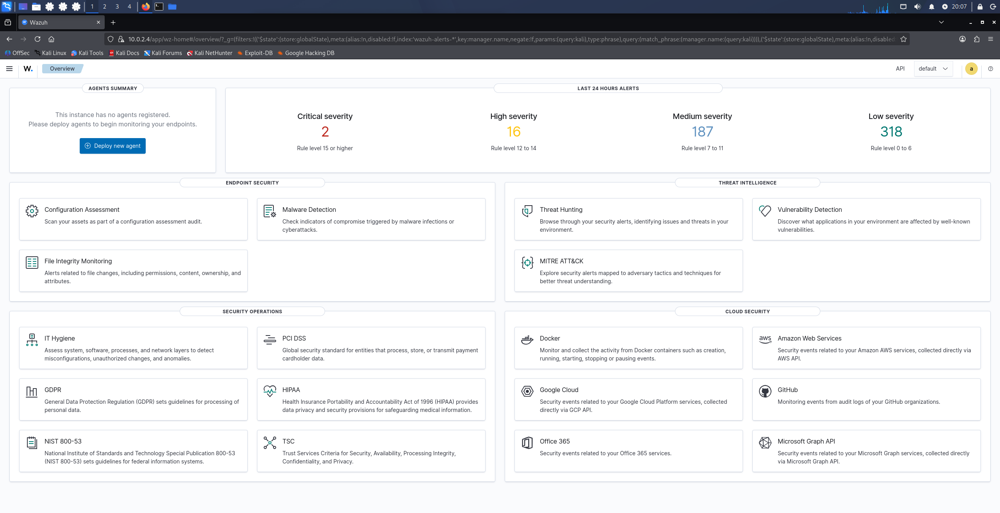
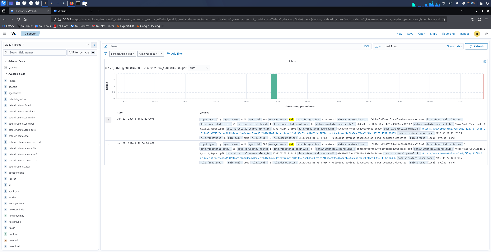
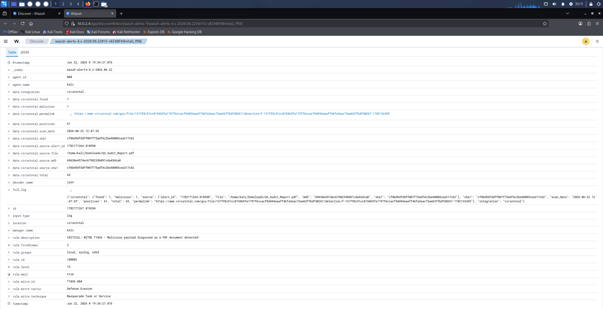
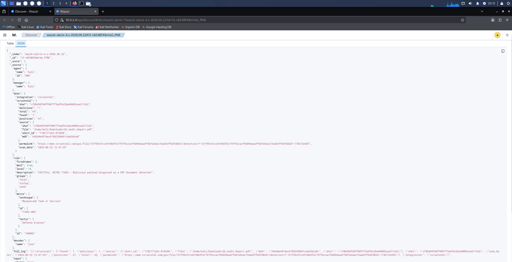
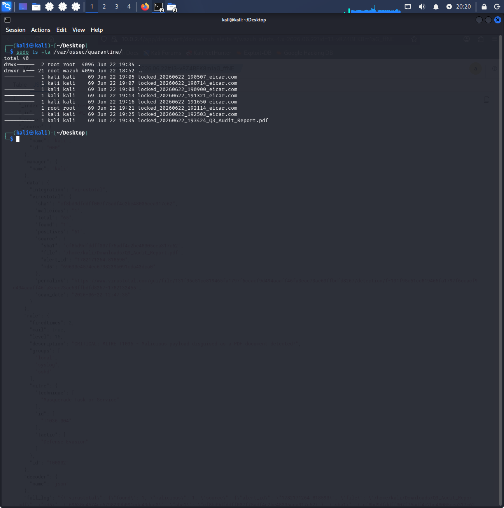
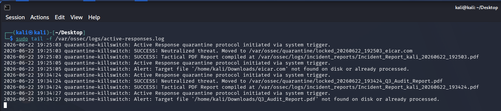
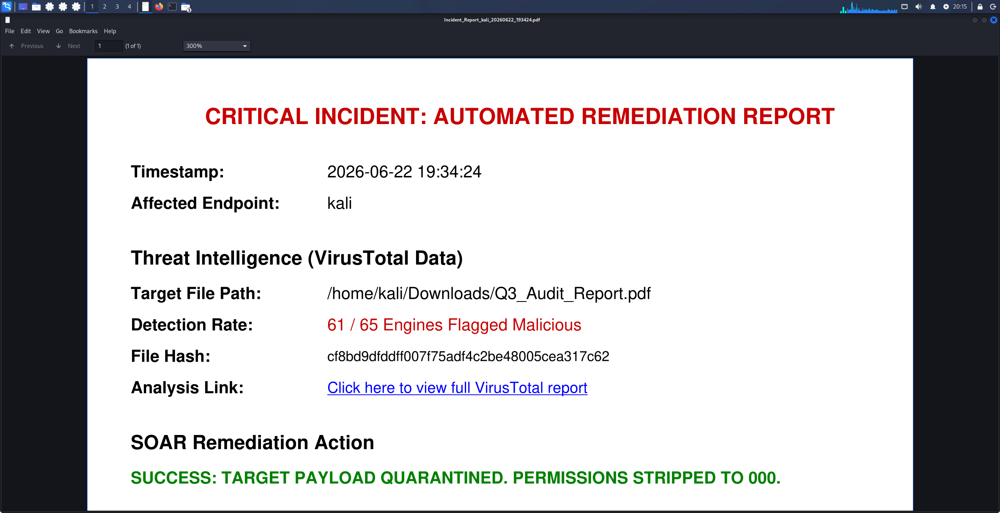
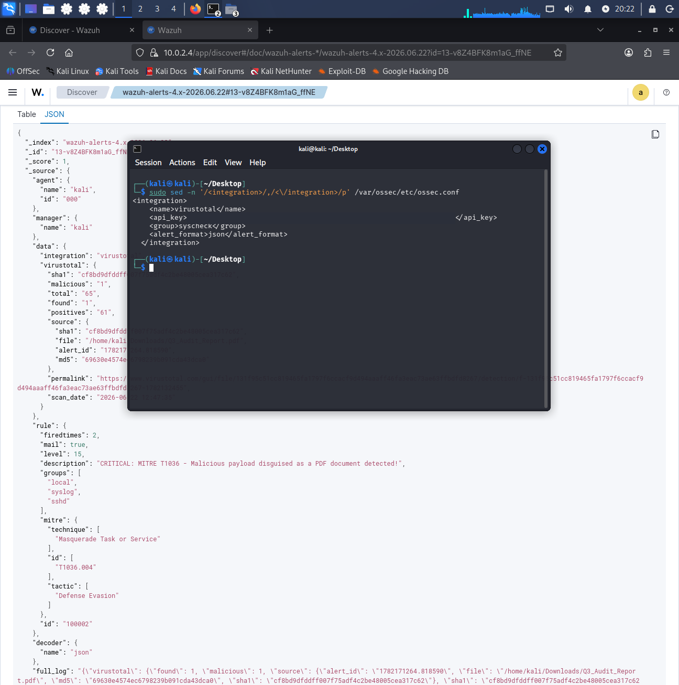
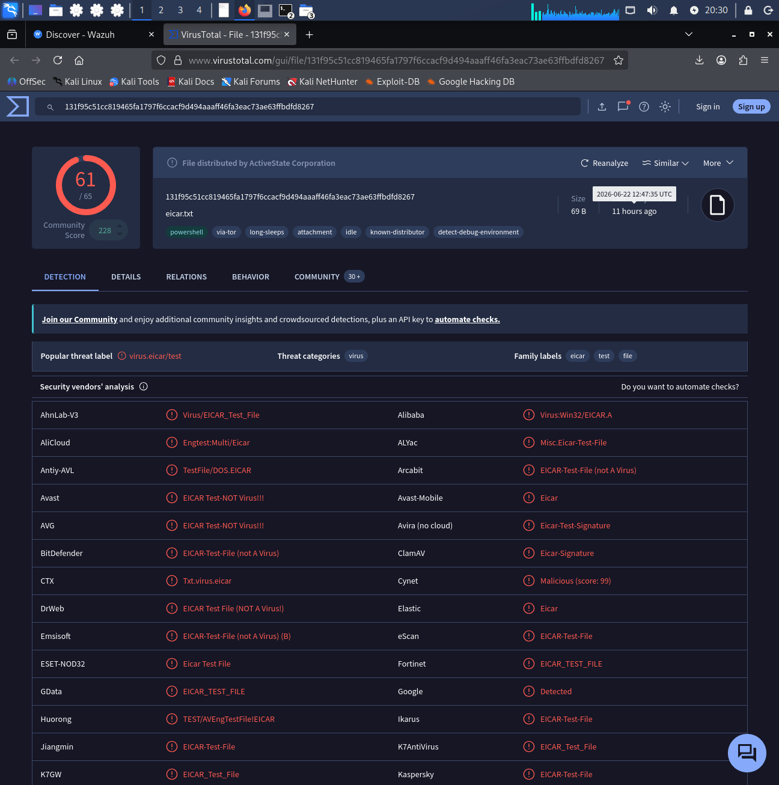

# VirusTotal API & Automated Malware Containment (SOAR)

## Project Overview
This project demonstrates a fully functional Security Orchestration, Automation, and Response (SOAR) pipeline engineered within Wazuh XDR. The architecture is designed to automatically intercept malicious file drops, query their cryptographic hashes against global threat intelligence databases, and autonomously execute a custom Python killswitch. This killswitch physically isolates the threat and generates a tactical incident report, reducing the time to remediation from minutes to milliseconds.

## Tools Used
* **Wazuh XDR:** Core SIEM, File Integrity Monitoring (FIM), and Active Response engine.
* **VirusTotal API:** External Threat Intelligence integration for hash verification.
* **Python 3:** Automation scripting, utilizing the `fpdf` library for dynamic reporting.
* **OpenSearch / Wazuh Dashboard:** Log aggregation, JSON telemetry parsing, and strategic reporting.
* **Linux (Debian/Kali):** Endpoint simulation and kernel-level file permission management.

## Project Steps
1. **FIM Configuration:** Configured Wazuh's File Integrity Monitoring to monitor the `/Downloads` directory in real-time for new file creation.
2. **API Integration:** Embedded a VirusTotal API key into the Wazuh manager (`ossec.conf`) to automatically cross-reference hashes of newly dropped files.
3. **Detection Engineering:** Authored a custom XML detection rule mapped to **MITRE ATT&CK T1036 (Masquerading)** to specifically flag malicious files attempting to disguise themselves as PDFs.
4. **Active Response Scripting:** Developed a Python-based execution engine (`quarantine-killswitch.py`) that triggers upon detection.
5. **Attack Simulation:** Deployed an EICAR test string disguised as a financial document (`Q3_Audit_Report.pdf`) to test the complete detection-to-remediation pipeline.

## Analysis
The core of the detection logic relies on a custom Wazuh rule (Level 15 - Critical). To detect the masquerading technique, the rule leverages a PCRE2 regular expression:
```xml
<rule id="100002" level="15">
    <if_sid>87105</if_sid>
    <field name="virustotal.source.file" type="pcre2">(?i)\.pdf$</field>
    <description>CRITICAL: MITRE T1036 - Malicious payload disguised as a PDF document detected!</description>
    <mitre>
      <id>T1036.004</id>
    </mitre>
  </rule>
```
This forces the engine to parse the incoming JSON telemetry and trigger only if the malicious payload explicitly attempts to hide behind a .pdf extension, regardless of capitalization. Furthermore, the Python script utilizes a "waterfall" hash extraction method, searching the nested JSON tree for a SHA-256 hash first, then back to SHA-1 or MD5 to ensure the threat intelligence hyperlink is always generated.

## Reporting 
This architecture utilizes a dual-layer reporting system:

1. **Technical Reporting (Python):** The Active Response script autonomously generates a PDF receipt the instant a file is quarantined, detailing the file path, VT detection rate, and a clickable analysis hyperlink.
2. **OpenSearch Telemetry (Wazuh):**  Visual dashboards and CSV exports generated via OpenSearch, allowing SOC managers to review threat trends over time.

## Key Findings
During the simulation, the pipeline performed exactly as engineered:
* The disguised payload (Q3_Audit_Report.pdf) was detected within seconds of hitting the disk.
* The Wazuh Manager successfully pulled a 61/65 malicious detection rate from VirusTotal.
* The custom Level 15 rule triggered, immediately deploying the Python killswitch.
* The script successfully moved the payload to a root-owned kernel vault (/var/ossec/quarantine) and successfully stripped all execution privileges (chmod 000), neutralizing the threat without human intervention

## Full Alerts Reports
The raw CSV telemetry and the automatically generated tactical PDFs for this incident simulation can be found in the `reports/` directory of this repository:

* [Technical Python Incident Report (PDF)](./reports/Incident_Report_kali_20260622_193424.pdf)
* [Wazuh Dashboard OpenSearch Telemetry (CSV)](./reports/Critical%20MITRE%20T1036%20PDF%20Alerts.csv)

## Screenshots

### 1. Main Dashboard Overview

*High-level view of the Wazuh security events dashboard and agent status.*

### 2. Critical Alert Trigger (MITRE T1036)

*Custom Level 15 rule triggering on the spear-phishing simulation.*

### 3. Alert Table Logs

*Tabular view of the security events log capturing the malicious file drop and initial VirusTotal hits.*

### 4. Raw JSON Telemetry Parse

*OpenSearch telemetry capturing the exact PCRE2 regex hit and nested API data.*

### 5. Quarantine Vault Validation

*Verification of the automated mitigation. Payload is isolated into a root-owned directory with all permissions successfully revoked (`000`).*

### 6. Terminal Execution Pipeline

*Real-time log monitoring showing the Active Response script firing and executing the containment lockdown.*

### 7. Automated Technical PDF Report

*The dynamically generated PDF compiled by the Python Active Response engine detailing the file path, VT detection rate, and clickable analysis hyperlink.*

### 8. Wazuh Manager API Integration

*Native XML API connector bridging internal FIM alerts with external threat intelligence.*

### 9. VirusTotal Portal Verification

*Global threat database matching for the payload hash, validating the SOC alert ecosystem.*

## Lessons Learned
* **Environment Sandboxing:** Bypassing strict PEP-668 Python environment restrictions required injecting the fpdf library directly into Wazuh's isolated, embedded framework rather than relying on global system packages.
* **JSON Complexity:** Parsing Wazuh's deeply nested alert JSON required building defensive, fault-tolerant Python logic (using .get()) to prevent the script from crashing if an expected key was missing.
* **Regex Precision:** Ensuring the End-of-String anchor ($) was utilized in the PCRE2 regex was critical to preventing false positives and ensuring only true .pdf masquerades were flagged.

## Next Steps
To further harden this SOC architecture, the following integrations are planned for future repository updates:

* **Shodan Integration:** Automating external attack surface monitoring to correlate internal alerts with exposed public-facing vulnerabilities.
* **YARA Rules:** Expanding detection capabilities beyond simple hash lookups by deploying custom YARA signatures to scan files for specific malware byte patterns and strings at the endpoint level.

**Disclaimer:** All malware simulations, API integrations, and Active Response executions demonstrated in this repository were conducted within a safely isolated and strictly controlled virtual environment. No production systems or external networks were exposed to malicious payloads during the development of this architecture.
